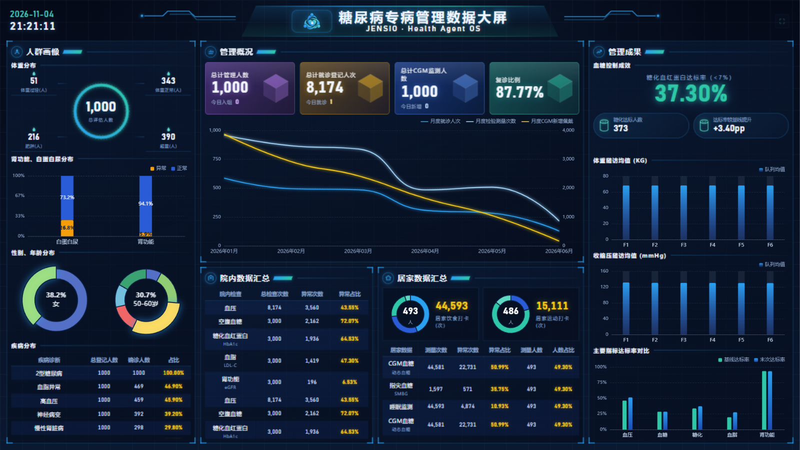

# 糖尿病专病管理数据大屏 (DRC Dashboard)

深海蓝科技医疗风的数据可视化大屏，基于 **1000 名虚拟 2 型糖尿病患者 × 180 天**的真实模拟数据聚合驱动。纯静态实现（原生 HTML/CSS/JS + 本地化 Apache ECharts），双击 `index.html` 即可离线运行，也可直接托管为静态站点。



## 快速开始

```text
双击 index.html（无需服务器、无需构建；ECharts 已本地化到 lib/，完全离线可用）
```

推荐按 F11 全屏演示；右上角有隐蔽式一键全屏按钮。1366×768 至 4K 显示器均按 1920×1080 逻辑画布等比缩放，不变形。

## 功能特性

- **1920×1080 等比缩放容器**：任意分辨率 / 非 16:9 窗口自适应居中，四周无缝延展
- **11 个业务模块**：人群画像（体重分层 / 肾功能·白蛋白尿 / 性别年龄 / 疾病分布）、管理概况（KPI 四卡 / 双轴月度趋势）、院内·居家数据汇总、管理成果（血糖控制成效 / 随访均值轨迹 / 达标率对比）
- **完整动效**：秒级实时时钟、环形图 3s 扇区轮播（鼠标悬停接管）、表格无缝滚动+悬停暂停、数字 CountUp 翻牌、Tooltip 自动巡检（容器内约束，不遮挡相邻模块）
- **数据钩稽自检**：页面加载时在控制台自动校验"异常占比 = 异常/总量、人数占比分母 = 管理总数、达标率与 pp 自洽"等公式
- **JENSIO 品牌化**：品牌蓝→青绿双色体系，LOGO 徽标经亮度映射重着色后嵌入

## 数据管道

大屏数据来自 `JENSIO_V3/mock/virtual_t2dm_1000x180d`（v2.1 reference 队列，1000 人，窗口 2026-01-01 ~ 2026-06-29）：

```bash
python -I tools/derive_dashboard_data.py   # 聚合 294MB 原始数据 → js/derived-data.js（约 6KB）
```

- 前端通过 `js/data.js` 的 `applyDerived()` 加载；`DRC.config.dataSource` 支持 `'derived'`（真实聚合）/ `'mock'`（演示回退）切换
- 指标口径（体重分层、异常/达标阈值、打卡分桶等）见脚本头部注释，改口径只需改脚本重跑
- challenge / debug / golden_cases / scenarios 为 Agent 评测集，按《数据合成方案》不并入大屏统计

## 目录结构

```text
├── index.html            # 页面骨架（Header + 左中右三栏 11 模块）
├── css/style.css         # 品牌主题、切角边框、动效
├── js/
│   ├── data.js           # 数据层：canonical 形状 + applyDerived + 钩稽自检
│   ├── derived-data.js   # 【自动生成】真实聚合数据（勿手改）
│   ├── core.js           # 缩放容器 / 时钟 / 调度 / CountUp / 轮播引擎
│   ├── charts-left.js    # 左栏 4 模块
│   ├── charts-center.js  # 中栏 3 模块
│   ├── charts-right.js   # 右栏 3 模块
│   └── main.js           # 入口
├── lib/echarts.min.js    # Apache ECharts 5.6.0 本地副本
├── assets/               # 品牌 LOGO（原图 / 裁剪版 / 品牌重映射版）
├── tools/                # 数据聚合脚本
└── docs/                 # 预览图
```

## 说明

- 患者数据为程序合成的**虚拟数据**，不含任何真实个人信息
- 字体：中文 Microsoft YaHei / PingFang SC，数字 Bahnschrift
- 适用于 Chrome / Edge 等现代浏览器
